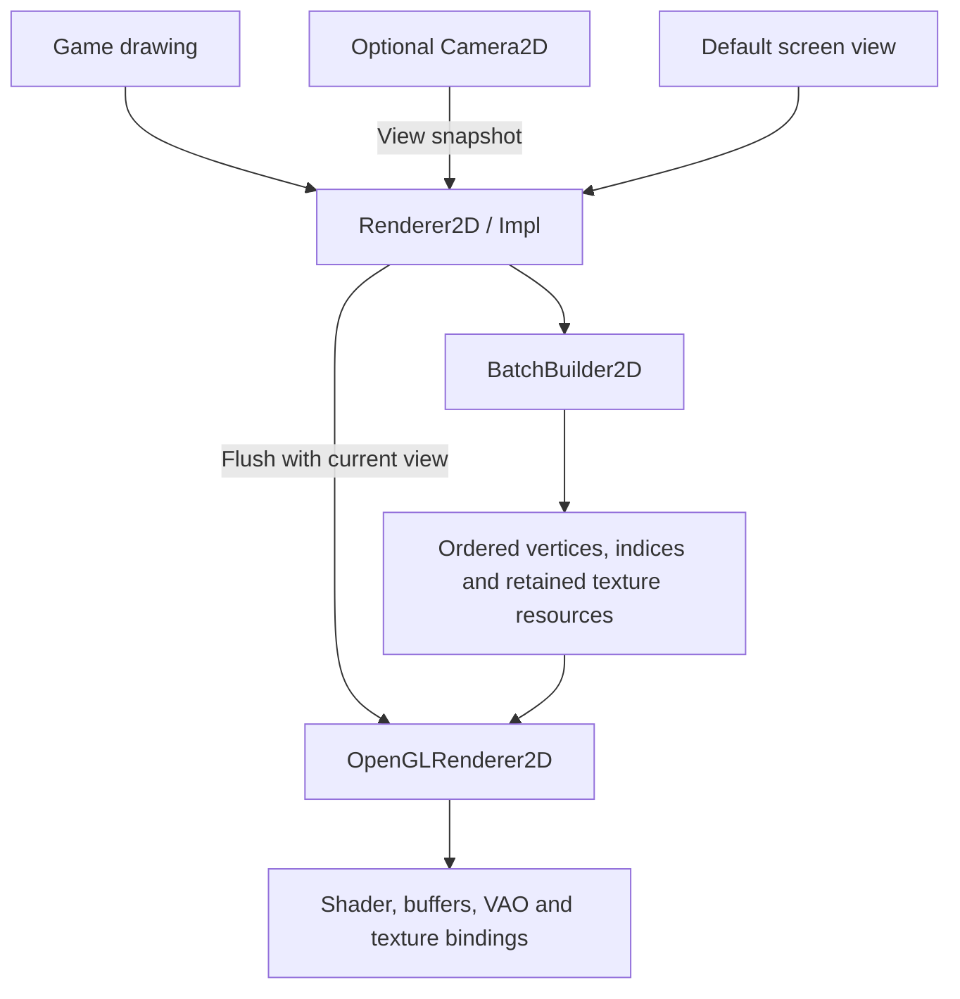

# Renderer2D

`Application` owns frame setup and presentation. Games can draw immediately without
constructing or selecting a camera:

```cpp
void render(forge::Renderer2D& renderer) override
{
    renderer.drawRect(
        {.position = {20, 20}, .scale = {100, 60}},
        forge::colours::Cyan
    );
}
```

Every frame starts with a screen view: `(0, 0)` is the top-left, X increases right,
and Y increases down. Coordinates use logical window units. `Window::frameInfo()`
queries current window and framebuffer sizes, so resizing and high-DPI displays
use the correct projection and physical GPU viewport. Custom engine loops call
`beginFrame(frameInfo, clearColour)` and `endFrame()` themselves. Frames with zero
physical or logical dimensions skip drawing safely.

## Optional camera

The game owns its camera and updates it after the objects it follows:

```c++
forge::Camera2D camera;

void onStart(forge::AssetManager&) override
{
    camera.setZoom(2.0f);
    
    camera.setSmoothing(0.15f); // Exponential smoothing time constant in seconds.
    camera.setLookAhead({40, 0});
    
    camera.follow(player);
    camera.snapToTarget();
}

void update(float deltaTime) override
{
    player.update(deltaTime);
    camera.update(deltaTime);
}

void render(forge::Renderer2D& renderer) override
{
    renderer.setCamera(camera);
    renderer.drawSprite(playerTexture, playerTransform);

    renderer.resetCamera();
    renderer.drawRect(healthBarTransform, forge::colours::Green);
}
```

`setCamera()` copies the calculated view matrix. Later camera mutations require
another `setCamera()` call to affect drawing. Camera selection affects subsequent
draws and never carries into the next frame. `resetCamera()` restores screen
coordinates immediately for HUD/UI.

Camera position denotes the world point at the screen centre. Zoom 2 doubles
rendered size; rotation is in radians. Smoothing 0 follows rigidly. Look-ahead X
flips with inferred horizontal movement, while Y is a constant offset.
`follow(player)` requires a stable player address until `stopFollowing()` or a new
follow target is selected. A position callback can support custom targets.
`stopFollowing()` and `setPosition()` allow manual camera control.

`shake(strength, duration)` uses world units and seconds. It changes the rendered
view without modifying the camera's base position. Image effects such as bloom
would belong to future rendering passes rather than camera behavior.

## Internal ownership



- `Renderer2D::Impl` owns the backend and CPU builder, manages frame/view state,
  and flushes before view changes, on capacity exhaustion, and at frame end.
- `RenderView2D` contains a matrix; it never owns or updates a camera.
- `BatchBuilder2D` generates world-space triangle geometry. It contains no OpenGL
  calls or headers. Failed capacity checks leave the batch unchanged so the
  renderer can submit, clear, and retry exactly once.
- `RenderBatch2D` retains shared private `GPUTexture` resources until submission.
  Public `Texture2D` is a copyable handle with no public GPU binding methods.
- `OpenGLRenderer2D` owns its shader, dynamic VBO/EBO, VAO and white texture through
  existing RAII wrappers. It uploads and draws batches synchronously. The window
  and its current context must outlive the renderer and every texture handle.

Shapes and sprites share one shader and preserve submission order. A white
texture provides solid colours. Textures are assigned up to eight slots per batch;
there is no global texture sorting. Current limits are 16,384 vertices and 24,576
indices. Dynamic buffers are invalidated and updated at submission; a persistent
mapped upload ring can replace that strategy without changing the public API.

The backend owns OpenGL state during drawing and currently renders to the default
framebuffer. Other GL renderers must establish their state at explicit boundaries;
arbitrary external GL calls between queued draws are unsupported. Render targets,
clipping and custom materials are future extensions, each requiring ordered state
boundaries rather than changes to the draw entry points.

## Geometry and textures

- Rectangle and sprite transforms map a unit quad from `(0, 0)` to `(1, 1)`;
  scale gives its dimensions. Triangle vertices are `(0, 1)`, `(1, 1)`, `(0.5, 0)`.
  Rotation is around the local origin, matching `Transform2D::matrix()`.
- Lines are triangle quads with butt caps, with thickness measured in world units.
  Zero-length lines and nonpositive thickness emit no geometry.
- Circles use 64 segments. Nonpositive or nonfinite radii emit no geometry.
- `fill = false` draws a connected outline centred on the boundary with a width of
  one world unit. Camera zoom scales line and outline widths with the world.
- Textures use top-row-first RGBA8 data, straight-alpha blending and the existing
  texture filtering/wrapping options. Uploads validate dimensions and pixel counts
  and preserve the caller's unpack-buffer and pixel-layout state.
- No automatic camera pixel snapping or antialiasing is applied. Smooth fractional
  movement remains available; applications requiring pixel-perfect movement should
  use an appropriate logical resolution and quantized final camera positioning.

## Validation

Configure with `-DFORGE2D_BUILD_TESTS=ON`, build, then run:

```sh
ctest --test-dir <build-directory> --output-on-failure
```

`forge2d-tests` runs CPU geometry, capacity, resource-retention and camera checks
without creating a GL context. `forge2d-renderer-gpu-tests` uses a hidden OpenGL 4.6
window and reads actual rendered pixels. It checks default coordinates, camera
snapshots, camera/HUD/frame boundaries, zoom, alpha order, both batch capacities,
texture lifetimes, primitives, logical scaling, zero-size frames, and uploads.
The GPU test returns skip code 77 when no compatible context can be created.

Pass an output `.ppm` path to `forge2d-renderer-gpu-tests` to save a rendered
primitive/texture preview. Debug loads the batch GLSL files from the shader
directory, which is copied beside application executables. All other build
configurations (including Release, RelWithDebInfo and MinSizeRel) compile embedded
batch shader sources into the engine and ignore the renderer's shader directory.
No shader folder is needed when distributing those builds.

CMake generates the embedded header from `engine/shaders/batch.vert.glsl` and
`batch.frag.glsl`; editing either file regenerates it on the next build. The GLSL
is still compiled and linked by the OpenGL driver at runtime. Release GPU tests
use an invalid shader directory to verify rendering without external shader files.
