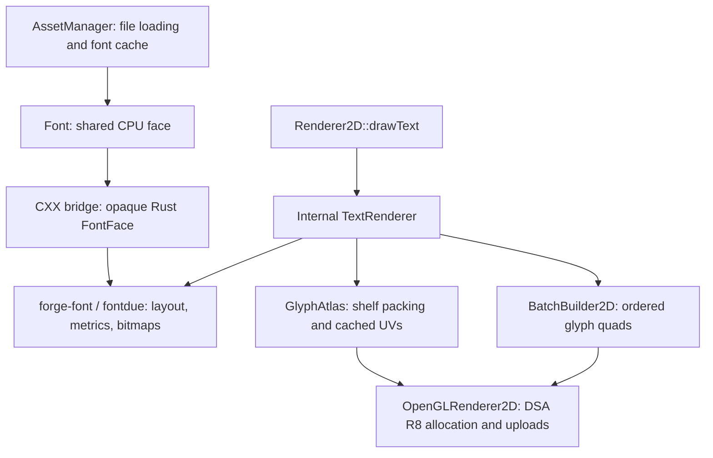

# Text rendering

The implementation follows the [text rendering design](markdown/TextRendering.md):
Rust parses and rasterises fonts; C++ packs glyphs into atlases and submits quads
through the existing ordered renderer. Games never manage atlas textures or Rust
objects.

## Game API

```c++
forge::Font font; // A cheap copyable handle, initially empty.

void onStart(forge::AssetManager& assets) override
{
    font = assets.loadFont("fonts/MyFont.ttf");
    // Also accepts forge::assets::FontAsset{"fonts/MyFont.ttf"}.
}

void render(forge::Renderer2D& renderer) override
{
    renderer.drawText(
        "Score: 1200", 
        font, 
        {20, 20}, 
        32,
        forge::colours::White
    );
}
```

`loadFont()` reads a TrueType/OpenType face under the configured asset root.
Repeated normalized paths return the same cached handle, independently of drawing
size. Missing, unreadable or invalid files throw `AssetError`; no system font is
selected implicitly. Successful references remain stable until the asset manager
is destroyed. Copy a `Font` to retain the CPU face beyond that lifetime. A pointer
to the cached handle is supported by the second `drawText()` overload, but that
pointer must not outlive the manager.

Font loading follows AssetManager's existing main-thread contract. Font handles
contain CPU resources only. Measuring text does not require an OpenGL context:

```cpp
const auto dimensions = font.measureText("Level complete!", 32);
```

Measurement returns the maximum line advance width and the total typographic
line-box height. It includes spaces, tabs and trailing newlines; it is not a tight
bounding box of visible ink. Empty strings and empty handles measure as zero.

## Coordinates and layout

Text position is the top-left of the first typographic line box in the renderer's
current coordinate system. The first baseline is `position.y + ascent`. Each glyph
uses `penX + xmin` horizontally and `baselineY - (ymin + bitmapHeight)` vertically,
so capitals and descenders share a baseline. Some glyphs can overhang the line box.

The size is a finite value in `(0, 512]` pixels per em. It is not a fixed glyph
height. Invalid non-empty text sizes throw `std::invalid_argument`. Text quads use
logical drawing coordinates, so camera zoom and framebuffer scaling also scale
the rasterised glyphs. There is no automatic DPI rerasterisation or pixel snapping.

Layout supports:

- UTF-8 decoding with U+FFFD replacement for malformed sequences.
- Pair kerning when supplied by fontdue for the loaded font.
- LF, CR and CRLF newlines using the font's horizontal line metrics.
- Tab stops every four space advances, measured from the line origin.
- Whitespace advance without uploading or drawing empty glyph bitmaps.
- A font's `.notdef` glyph for unsupported Unicode characters.

Other control characters are ignored. This is basic left-to-right layout, not
OpenType shaping: bidi reordering, ligatures, combining-mark positioning, wrapping,
alignment, automatic font fallback and colour emoji are not implemented.

## Cameras, colour and draw order

```cpp
renderer.setCamera(camera);
renderer.drawText("Enemy", font, enemyLabelPosition, 20); // World text.

renderer.resetCamera();
renderer.drawRect(panelTransform, panelColour);
renderer.drawText("Health: 100", &font, {20, 20}, 24);    // HUD text.
renderer.drawSprite(cursorTexture, cursorTransform);     // Drawn after the text.
```

Text participates in the same batch as shapes and sprites. It is not deferred to
an end-of-frame text pass. Tint RGB and alpha combine with grayscale glyph
coverage under straight-alpha blending. Drawing an empty string, empty handle or
null font pointer emits nothing.

## Internal boundaries



- The bridge uses CXX `Box`, slices, shared structs and Rust-owned vectors. C++
  never frees Rust allocations directly. Parser/layout/rasteriser panics are
  caught at the bridge and converted into errors; unrecoverable allocation aborts
  remain process-fatal.
- The atlas cache distinguishes face ownership, exact float size and glyph ID.
  Layout calculates placement on each call; rasterisation and upload occur only
  on a glyph cache miss.
- Each face uses append-only 1024x1024 R8 pages with one transparent texel of
  padding around each glyph. Pages are zero-initialised, linearly filtered, and
  never repacked. R8 is swizzled to `(1, 1, 1, coverage)`, so the existing sprite
  shader handles tint and coverage without extra shader state.
- Glyph pages occupy ordinary batch texture slots. Capacity exhaustion flushes
  and retries the glyph, preserving submission order. Queued batches retain page
  resources through submission, even if their font handles are released.
- Expired font faces are pruned from atlas caches at the next frame boundary.
  The atlas has an internal limit of 16 pages per live face, shared across its
  sizes. A glyph larger than a page or an exhausted page budget throws
  `std::length_error`; no previously queued UVs are invalidated. The internal
  `GlyphAtlas` constructor accepts page size and budget for testing or tuning.
- All GL calls stay in the OpenGL backend/resource layer. Allocation and updates
  use DSA and preserve pixel-unpack buffer, alignment, row length and skip state.
  Drawing and GPU resource destruction require the owning context to be current.

## Validation

```sh
cargo test -p forge-font --target x86_64-pc-windows-gnu --locked
cmake -S . -B <build-dir> -DFORGE2D_BUILD_TESTS=ON
cmake --build <build-dir>
ctest --test-dir <build-dir> --output-on-failure
```

Use a Rust target matching your C++ toolchain; the command above matches Windows
MinGW. CMake generates the font bridge alongside the existing image/audio bridge.

`forge2d-text-tests` checks CPU-only loading, measurement, layout, UTF-8, validation
and padded shelf packing. `forge2d-text-gpu-tests` uses a hidden OpenGL window to
check coverage, tint/alpha, cache reuse, ordered drawing, camera/HUD state, geometry
and texture-slot rollover, stable atlas UVs, face expiry and unpack-state handling.
Like the existing renderer GPU test, it skips with code 77 if no suitable GL
context is available.

For a rendered sample, run:

```sh
<build-dir>/bin/forge2d-text-gpu-tests <build-dir>/text-preview.ppm
```

Tests bundle an unmodified Ubuntu Light font and its Ubuntu Font Licence under
`tests/fixtures/fonts`. Games supply and license their own fonts; the engine does
not silently depend on an installed system font or ship an automatic default.
