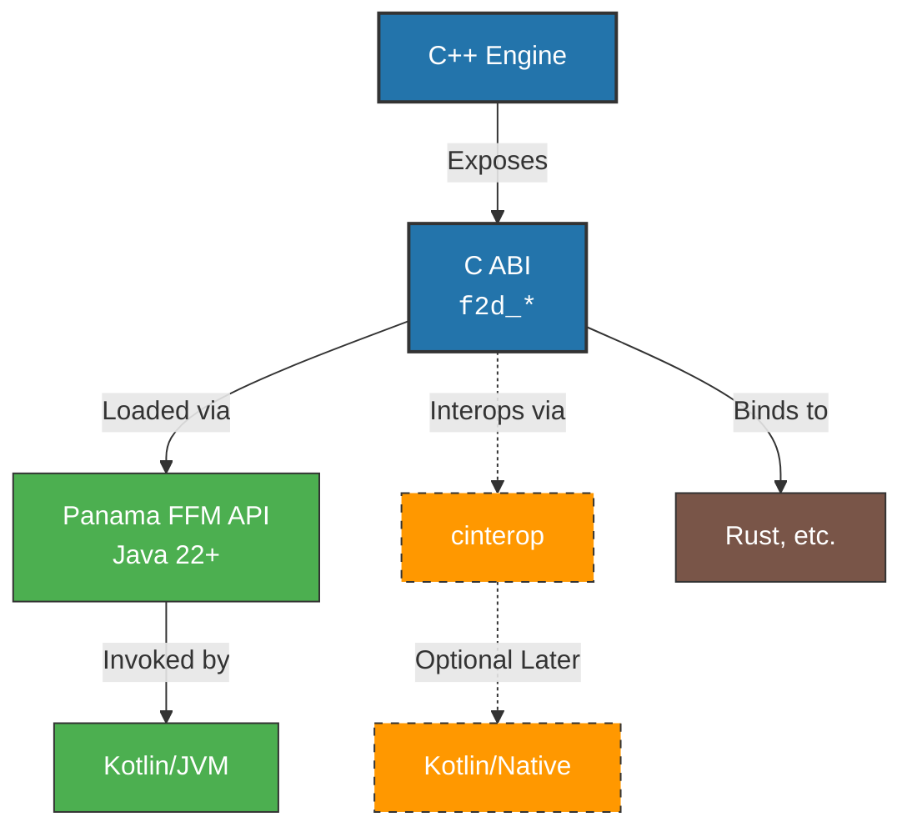

(31 - 10 - 2026)
## Kotlin Scripting in Forge2D 

#### Writing game code in the language Kotlin

This is an eventual feature of Forge2D that will let developers write game code in the Kotlin programming language
via a flat C API (`forge2d_c.h`). This may also be extended to allow users to write game code in the engine's secondary
core langauge, Rust.

The Kotlin side should be kept close to what is currently in C++ under `games/platformer/src`: a `Game` class with 
lifecycle methods, config passed in as named arguments, and input that gets polled each frame. The parts that need more
thought are underneath the general syntax: how calls cross from Kotlin into C++/Rust, who owns resources as Kotlin's
memory allocation is run via the JVM, and how draw calls get batched.

### Where the Kotlin side should end up

`main.kt`: named arguments with defaults do the same job as the current C++ designated initialisers.
```kotlin
fun main() = Application(
    window = WindowConfig(
        title = "Forge2D Platformer"
        width  = 800,
        height = 600,
        vsync  = true,
    )
).run(PlatformerGame())
```

`PlatformerGame.kt`:
```kotlin
class PlatformerGame : Game() {

    private val player = assets.texture("textures/player.png")   // a handle, not a GPU object
    private var position = Vec2(100f, 100f)

    override fun onStart() = log.info { "Platformer started!" }
    override fun onStop()  = log.info { "Platformer stopped!" }

    override fun update(time: Time) {
        if (Key.D.isDown) position += Vec2.RIGHT * 200f * time.delta
        if (Key.A.isDown) position += Vec2.LEFT  * 200f * time.delta
    }

    // The renderer is the receiver here, so draw calls need no "renderer." prefix
    override fun Renderer2D.render() {
        clear(Colour.CORNFLOWER_BLUE)
        sprite(player, at = position)
        rect(Transform2D(position = Vec2(0f, 550f), size = Vec2(800f, 50f)), Colour.DARK_GREY)
    }
}
```

This maps directly onto conventional game code (`Input::isKeyDown(Key::D)`, `renderer.drawSprite(texture, pos)`), so
the C++ and Kotlin frontends stay one-to-one. 

Kotlin in these examples add a few things on top however:
- operator overloading on `Vec2` (Is in C++ and is being added to the C++ end)
- `Key.D.isDown` as an extension property
- a renderer receiver (`fun Renderer2D.render()`) instead of a parameter
- `Time` instead of a bare `float`, since there are already `Time` and `Clock` classes in the C++/Rust engine.

Later, once scenes have been added, the same idioms extend to a Unity-style component layer without breaking the simple
`Game` API.
```kotlin
class PlayerController : Behaviour() {
    var speed = 200f
    override fun update(time: Time) {
        if (Key.D.isDown) transform.position += Vec2.RIGHT * speed * time.delta
    }
}

val level1 = scene {
    entity("player") {
        transform(position = Vec2(100f, 100f))
        sprite(assets.texture("textures/player.png"))
        behaviour<PlayerController> { speed = 250f }
    }
}
```

The DSL should be kept for scene and entity building, where nesting really helps. For configs, plain data classes
are enough.

### How Kotlin talks to the engine

C++ classes will not be bound directly to their Kotlin counterparts. Instead, a flat C API (`forge2d_c.h`) should be
put between them and the Kotlin layer will be built on that:


- Kotlin/JVM with Panama (FFM) is the better choice between it and the JNI. Native calls are much cheaper and less
  error-prone than the JNI, and hot-reload and the general JVM ecosystem is more prominent. this cost is shipping a
  JRE and garbage collection is something that should be kept in mind.

- Kotlin/Native with CInterop has no JVM, but compiles slowly and has no real hot-reload. That hurts for game-style
  scripting

- Who owns `main`: the simplest setup has Kotlin owning `main` and loading the engine as a shared library, just like
  LWJGL and libGDX. Embedding a JVM inside the C++ main works too, but adds a lot of hassle.

### Three design rules that affect the current C++ side
- **Resources are handles**: `Texture` on the Kotlin side should be `@JvmInline value class Texture(val id: UInt)`,
  with the engine owning the actual GL texture. Garbage Collection finalisers shouldn't be used for GPU resources;
  explicit `unload()` or asset-manager lifetimes should be used instead.

- **Batch draw calls; don’t make one native call per draw**: Kotlin's `sprite(...)` should write into a shared command
  buffer (a `MemorySegment`), and the engine flushes it once per frame. This fits the sprite/shape batching currently
  in the TODO list.

- **`Vec2` must not allocate**: A Kotlin value class can only hold one field, so the two `x`, `y` floats should be
  packed into a single `Long`, the way Compose's `Offset` does. This should also come with the full conversion of the
  C++ `Vec2`, `Colour`, and `Transform2D` into pure data with `static_assert(std::is_standard_layout_v<...>)`, so they
  can be passed across the boundary by value, since Kotlin has no Pass-By-Reference.

### Changes to the current C++ API that would make this easier
- `Game` could become a callback table. `Application` right now takes in a `std::unique_ptr<Game>`, which a foreign
  language can't easily subclass. As the C level, a struct of function pointers plus a `void* userData` would make this
  much easier, then the C++ `Game` can be turned into an adapter over that. The Kotlin `Game` is then just another
  adapter.

- Exceptions must not cross the boundary. Under `games/platformer/src`, `main.cpp` catches exceptions right now. The
  C API should return error codes or a last-error string, and Kotlin turns those back into exceptions.


