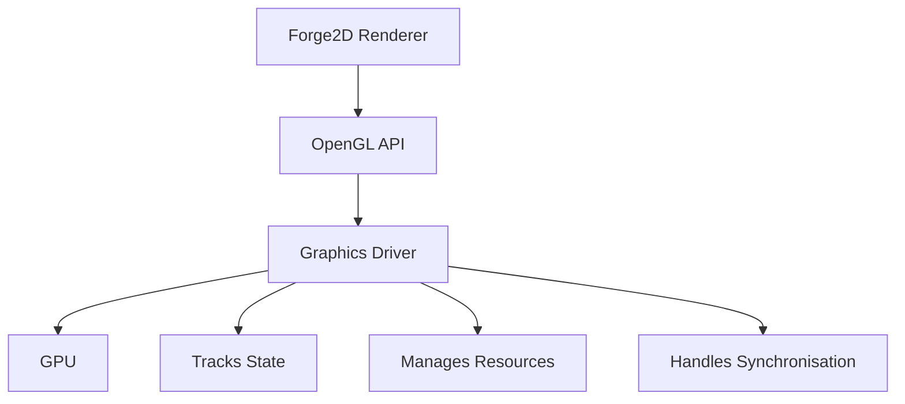
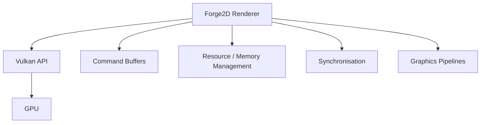
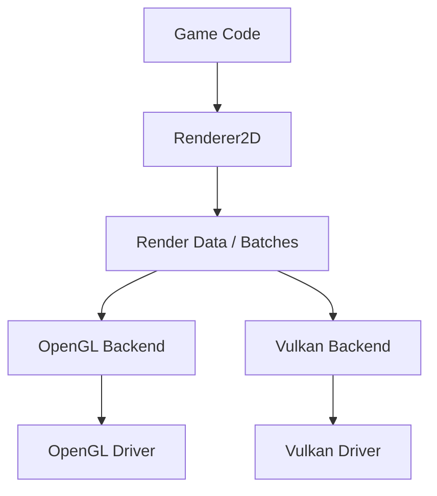
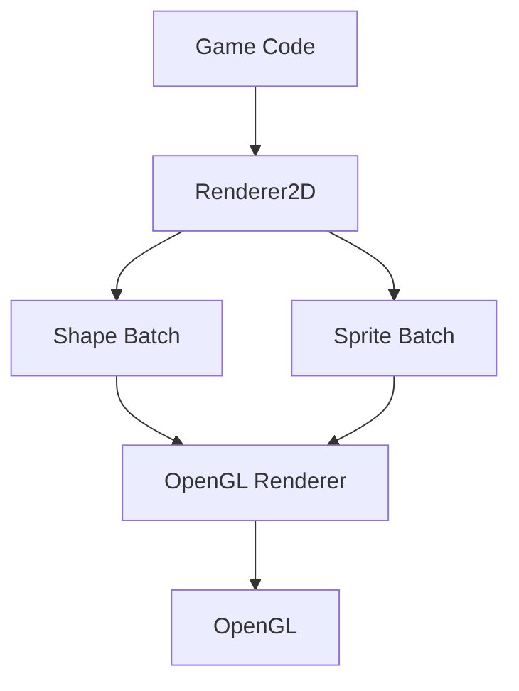
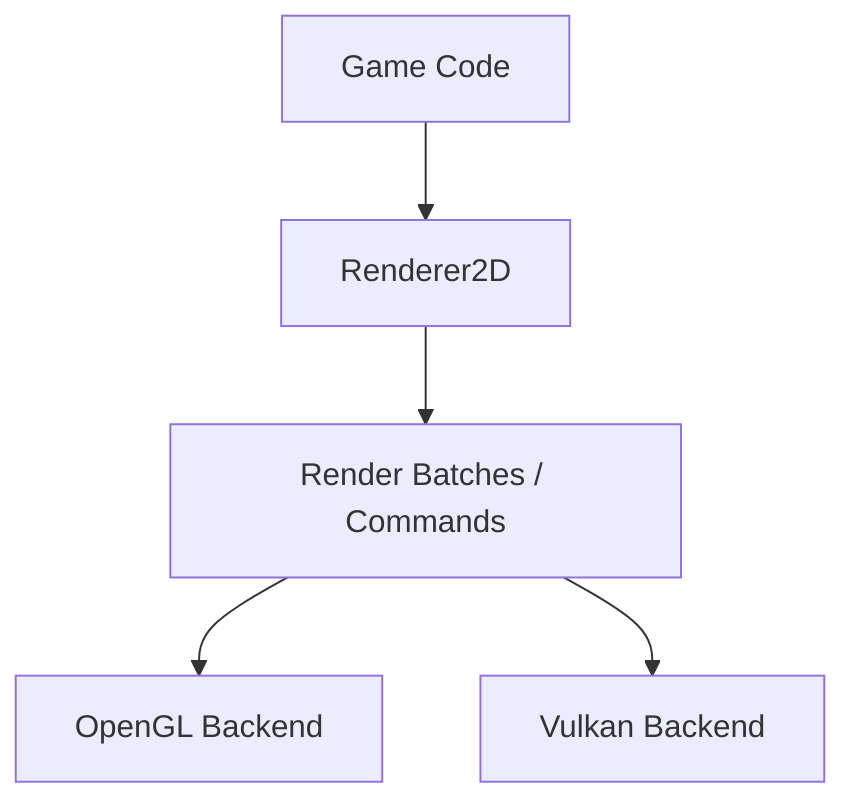

(4 - 11 - 2026)

## OpenGL vs Vulkan in Forge2D

#### What the two APIs do differently, and whether Forge2D actually needs both

Right now Forge2D uses OpenGL as its rendering API. OpenGL has been really good for learning how the renderer works
because the API is relatively small, and a lot of the concepts are easy to see directly: Vertex Buffers, Vertex Arrays,
shaders, uniforms, textures, framebuffers, blending, and eventually things like instancing and post-processing.

Vulkan is another graphics API from Khronos, and it is usually described as the "modern" alternative to OpenGL. That
description is technically true in some ways, but it also makes Vulkan sound like OpenGL 2.0, which it really isn't. 
It is **not a direct replacement for OpenGL**. OpenGL asks the driver to manage a lot of graphics state and resource
lifetime behind the scenes, while Vulkan moves a much larger amount of that responsibility into the application itself.

That means Vulkan can give an engine more control and potentially lower CPU overhead, but it also means the engine has
to do a lot more work itself.

For Forge2D, the question isn't really:

> "Which API is better?"

It is more:

> "What does Forge2D gain from supporting one, the other, or both?"

---

### The basic difference

The largest difference is how much work the graphics driver does on behalf of the application.

With OpenGL, rendering usually looks something like:

```c++
shader.bind();
vertexArray.bind();
texture.bind();

shader.setMat4("uViewProjection", camera.viewProjection());

glDrawElements(
    GL_TRIANGLES,
    indexCount,
    GL_UNSIGNED_INT,
    nullptr
);
```

This looks fairly simple, but there is a lot going on underneath it.

OpenGL keeps a large amount of global graphics state. `glBindVertexArray`, `glUseProgram`, `glBindTexture`, blending,
the current framebuffer, and many other things all modify that state. When `glDrawElements` is finally called, the
driver looks at the state that is currently active and works out what needs to happen on the GPU.

A rough diagram would look like:



Vulkan moves a lot of those responsibilities out of the driver:



Obviously the Vulkan driver still exists, but the application has to explicitly describe far more of the work that
OpenGL normally infers.

---

### OpenGL's state machine

One of the biggest things that had to be learnt while building the current renderer is that OpenGL is a state machine.

For example:

```c++
shapeShader.bind();
shapeShader.setVec4("uColour", colour);

quadVertexArray.bind();

glDrawElements(
    GL_TRIANGLES,
    6,
    GL_UNSIGNED_INT,
    nullptr
);
```

The draw call uses whatever state is active at that exact point.

Changing the shader colour after `glDrawElements` does not change the rectangle that was already drawn. The draw has
already been processed and its fragments have already been written into the framebuffer.

That model makes OpenGL fairly approachable:

```text
set state
    ↓
set more state
    ↓
draw
    ↓
change state
    ↓
draw again
```

The downside is that this state is hidden and shared. A renderer has to be careful about what is currently bound, and
the driver has to do validation and state tracking when commands are submitted.

This is one of the areas Vulkan handles very differently.

---

### Vulkan graphics pipelines

Vulkan does not have the same idea of slowly modifying one large global graphics state.

Instead, a lot of the state needed to render something is collected into a **graphics pipeline**.

A graphics pipeline can describe things like:

- Vertex and fragment shaders
- Vertex input layout
- Primitive topology
- Rasterisation settings
- Blending
- Depth and stencil behaviour
- Multisampling
- Render target formats

Instead of doing:

```c++
glUseProgram(...);
glEnable(GL_BLEND);
glBlendFunc(...);
glPolygonMode(...);
```

throughout rendering, Vulkan generally expects compatible pipeline objects to already exist.

The renderer then records commands such as:

```text
bind pipeline
bind vertex buffer
bind index buffer
bind descriptor data
draw indexed
```

into a command buffer.

This is a much more explicit design, but it also means there is a much larger amount of setup before the first
triangle can even be drawn.

---

### Command buffers

OpenGL calls mostly execute through an immediate-looking API:

```c++
glBindVertexArray(...);
glDrawElements(...);
```

The driver receives those calls and decides how to queue the actual GPU work.

Vulkan uses **command buffers** instead. The application records rendering commands first:

```text
begin command buffer
    ↓
begin rendering
    ↓
bind pipeline
    ↓
bind buffers
    ↓
draw
    ↓
end rendering
    ↓
end command buffer
```

That finished command buffer can then be submitted to a GPU queue.

This is one of the reasons Vulkan is better suited to heavily multithreaded renderers. Multiple threads can prepare
work without everything having to pass through the same OpenGL-style state machine.

For Forge2D however, the renderer is a 2D renderer. Proper batching should already reduce thousands of game objects
into a relatively small number of GPU submissions.

A sprite batch might turn:

```text
2,000 sprites
```

into:

```text
1-10 GPU draw calls
```

depending on texture limits, materials and batch capacity.

That greatly reduces how much Forge2D would benefit from Vulkan's lower command submission overhead in the first place.

---

### Memory management

Another major difference is GPU memory management.

With OpenGL, creating a buffer is fairly simple:

```c++
glCreateBuffers(1, &id);

glNamedBufferData(
    id,
    size,
    data,
    GL_DYNAMIC_DRAW
);
```

The driver decides where the resource should live and handles most of the memory allocation details.

Vulkan is far more explicit.

A simplified Vulkan buffer setup involves roughly:

```text
create VkBuffer
    ↓
ask Vulkan for its memory requirements
    ↓
choose a suitable memory type
    ↓
allocate VkDeviceMemory
    ↓
bind that memory to the buffer
```

```c++
VkBufferCreateInfo bufferInfo {
    .sType =
        VK_STRUCTURE_TYPE_BUFFER_CREATE_INFO,

    .size = size,

    .usage =
        VK_BUFFER_USAGE_VERTEX_BUFFER_BIT,

    .sharingMode =
        VK_SHARING_MODE_EXCLUSIVE
};

VkBuffer buffer =
    VK_NULL_HANDLE;

vkCreateBuffer(
    device,
    &bufferInfo,
    nullptr,
    &buffer
);
```

Libraries such as Vulkan Memory Allocator exist because doing all of this well is a fairly substantial subsystem by
itself.

This extra control can be useful for a large engine, but Forge2D has to actually need that control before it becomes
a benefit rather than extra code.

---

### Synchronisation

OpenGL hides a lot of GPU synchronisation.

Usually I can upload some data and issue a draw:

```c++
buffer.setData(vertices);
glDrawElements(...);
```

without manually describing every dependency between the transfer and rendering operations.

Vulkan makes synchronisation far more explicit.

The renderer may need to think about:

- Fences
- Semaphores
- Pipeline stages
- Access masks
- Image layouts
- Resource barriers
- Which queue owns a resource

This gives Vulkan much more predictable control over when GPU operations happen, but incorrect synchronisation can
cause anything from visual corruption to GPU hangs.

This is probably one of the largest jumps between learning OpenGL and learning Vulkan.

---

### Shader differences

The shader concepts themselves transfer fairly well.

Forge2D currently uses GLSL shaders similar to:

```glsl
#version 460 core

layout(location = 0) in vec3 aPosition;
layout(location = 1) in vec4 aColour;

uniform mat4 uViewProjection;

out vec4 vertexColour;

void main()
{
    vertexColour = aColour;
    gl_Position  = uViewProjection * vec4(aPosition, 1.0);
}
```

The actual ideas still exist in Vulkan:

- Vertex inputs
- Vertex outputs
- Fragment inputs
- Uniform-like data
- Textures
- Samplers

The major difference is how that shader data gets connected to the application.

OpenGL compiles and links shaders into a program at runtime:

```text
GLSL
 ↓
compile shader stages
 ↓
link program
 ↓
glUseProgram
```

Vulkan normally consumes shaders as **SPIR-V** modules:

```text
GLSL
 ↓
shader compiler
 ↓
SPIR-V
 ↓
VkShaderModule
 ↓
graphics pipeline
```

So Forge2D would likely add a shader compilation step to the build/resource pipeline for a Vulkan renderer.

---

### Why Vulkan can be faster

Vulkan is often described as "more performant" than OpenGL, but that is not a guarantee.

A more accurate way to describe it is:

> Vulkan gives the application more opportunities to avoid driver overhead.

Some of the possible advantages are:

- Less hidden driver state tracking
- More predictable resource management
- Explicit synchronisation
- Better support for multithreaded command generation
- Pipeline state that can be prepared ahead of rendering
- More direct control over GPU queues and memory

These things matter a lot in engines that submit enormous amounts of rendering work.

Forge2D may not have that problem.

If the renderer batches efficiently, the CPU side may only make a small number of draw calls each frame anyway.

For example:

```text
Before batching:

2,000 sprites
= ~2,000 draw calls

After batching:

2,000 sprites
= maybe a handful of draw calls
```

At that point, replacing OpenGL with Vulkan is not automatically going to transform the game's performance.

A badly designed Vulkan renderer can also be slower than a well designed OpenGL renderer.

---

### Why OpenGL is still useful

If Vulkan eventually exists, it raises an obvious question:

> Why keep OpenGL at all?

There are a few valid answers.

#### 1. OpenGL is much simpler

The OpenGL renderer is easier to build, understand and debug.

A basic OpenGL renderer needs concepts such as:

```text
Shader
Buffer
VertexArray
Texture
Framebuffer
Batch
```

A Vulkan renderer needs those same general rendering concepts plus things such as:

```text
Instance
Physical Device
Logical Device
Queue Families
Swapchain
Command Pools
Command Buffers
Descriptor Pools
Descriptor Sets
Pipeline Layouts
Graphics Pipelines
Semaphores
Fences
Memory Allocators
```

That is a lot of code for a small 2D engine.

OpenGL therefore makes a good simple implementation even if Vulkan exists.

#### 2. OpenGL can act as a reference renderer

If the same Forge2D scene works correctly in OpenGL but is broken in Vulkan, that gives a useful debugging clue.

For example:

```text
Platformer
    ↓
Renderer2D API
    ├── OpenGL backend → correct
    └── Vulkan backend → black sprites
```

That immediately suggests the game logic and high-level render data are probably correct, and the issue is likely in
the Vulkan implementation.

Having two implementations can therefore help validate the renderer abstraction itself.

#### 3. Hardware and driver support

OpenGL has existed for decades and is available across a very large range of desktop hardware and operating systems.

Vulkan targets newer hardware and drivers.

An OpenGL backend could therefore be kept as a compatibility renderer while Vulkan becomes the preferred renderer on
machines where it is available.

#### 4. Different project requirements

Not every Forge2D game needs the same rendering complexity.

A tiny platformer may gain nothing meaningful from Vulkan.

A much larger project using large particle systems, heavy post-processing, compute work or a multithreaded renderer
might benefit from Vulkan's explicit model.

This could eventually make the graphics backend a configuration option:

```c++
forge::ApplicationConfig config {
    .graphics {
        .backend = forge::GraphicsBackend::OpenGL
    }
};
```

or:

```c++
forge::ApplicationConfig config {
    .graphics {
        .backend = forge::GraphicsBackend::Vulkan
    }
};
```

An automatic mode could also exist later:

```c++
.backend = forge::GraphicsBackend::Auto
```

although that should only exist if both backends are actually maintained well enough to be interchangeable.

---

### The cost of having two renderers

This is probably the strongest argument **against** Vulkan in Forge2D.

Two graphics APIs means two implementations of almost every rendering feature.

If Forge2D adds:

- Sprite batching
- Shape batching
- Cameras
- Render targets
- Framebuffers
- MSAA
- Lighting
- Post-processing
- Texture arrays
- Instancing
- Debug drawing

then each feature needs to work through both backends.

The structure becomes something like:



This is a good architecture **if Forge2D genuinely needs both implementations**.

If Vulkan only exists because "real engines use Vulkan", then it doubles a large amount of rendering work for very
little benefit.

Forge2D is still primarily a one-person engine, so maintenance cost matters a lot.

Time spent implementing every renderer feature twice is time not spent on:

- Input
- Asset Management
- Scenes
- Entity APIs
- Audio
- Physics
- Animation
- Kotlin game code
- Rust subsystems
- Editor tooling

For now, those systems are probably more valuable than a second graphics backend.

---

### Backend abstraction

Forge2D should still avoid tying the whole engine directly to OpenGL.

That doesn't mean creating an interface for every GPU object.

Something like this would be too OpenGL-shaped:

```c++
class VertexBuffer
{
    public:
        virtual void bind() = 0;
};
```

Vulkan does not naturally work around the same global binding model, so making every backend pretend to behave like
OpenGL would create a bad abstraction.

The useful abstraction should happen higher up:

```text
Renderer2D
    ↓
Render batches / render commands
    ↓
Graphics backend
```

The backends are then free to implement those concepts differently.

OpenGL might process a sprite batch by doing:

```text
update dynamic buffer
    ↓
bind texture set
    ↓
bind shader
    ↓
draw indexed
```

Vulkan might process the same batch by doing:

```text
write/update GPU data
    ↓
bind pipeline
    ↓
bind descriptors
    ↓
record indexed draw
    ↓
submit command buffer
```

The public game code should not change.

That is probably the most important reason to keep the current OpenGL code separated from `Renderer2D` even if Vulkan
never actually gets implemented.

A clean backend boundary is still useful architecture on its own.

---

### Windowing with GLFW

The current window implementation uses GLFW, which also works well with a future Vulkan backend.

For OpenGL, GLFW creates the window and OpenGL context:

```text
GLFW Window
    ↓
OpenGL Context
    ↓
GLAD
    ↓
OpenGL
```

A Vulkan window would instead be created without an OpenGL context:

```c++
glfwWindowHint(
    GLFW_CLIENT_API,
    GLFW_NO_API
);
```

GLFW can then be used to create the Vulkan presentation surface.

That means Forge2D's window/input layer does not need to be replaced just because the graphics backend changes.

The graphics API and the operating-system window are two separate responsibilities.

---

### Platform differences

Neither API is perfect on every platform.

OpenGL has very broad desktop support, although development of the desktop specification has mostly settled around
OpenGL 4.6.

Vulkan is the more modern explicit API on Windows and Linux, but Apple platforms are based around Metal rather than a
native Vulkan driver. Vulkan can still run on Apple platforms through Vulkan-to-Metal portability implementations, but
this is another good example of why "Vulkan replaces OpenGL everywhere" is too simple.

If Forge2D ever becomes heavily focused on native platform support, the long-term backend picture might actually look
more like:

```text
Windows / Linux
    └── Vulkan

macOS
    └── Metal

Compatibility
    └── OpenGL
```

That is very far into the future however, and Forge2D should not be designed around hypothetical platform backends
before the actual engine needs them.

---

### Where Forge2D should end up for now

For the current engine, OpenGL should remain the main and only production renderer.

The architecture should still look roughly like:



The important part is that the rest of the engine should not depend directly on OpenGL.

If Vulkan is added later, the target becomes:



Adding Vulkan should ideally be a test of the existing architecture:

> Can the platformer run through Vulkan without changing its game code?

If the answer is yes, the renderer boundary is doing its job.

---

### Reasons to eventually add Vulkan

For Forge2D specifically, Vulkan makes sense if at least one of these becomes true:

- It is useful for learning modern explicit graphics APIs.
- OpenGL driver overhead becomes a measured bottleneck.
- Forge2D needs more explicit GPU memory control.
- The renderer becomes heavily multithreaded.
- Compute work becomes important.
- Vulkan provides platform/features that the OpenGL backend cannot provide cleanly.
- Maintaining the second backend helps validate the renderer architecture.
- Forge2D grows enough that multiple rendering backends become a real project goal.

"Vulkan is newer" is not enough by itself.

---

### Reasons not to add Vulkan yet

Right now:

- OpenGL is more than capable of rendering a 2D game.
- The renderer is still evolving.
- Sprite/shape batching is already solving the largest obvious draw-call problem.
- Input, assets, scenes, audio and scripting are still more important engine systems.
- Every rendering feature would have to be written and tested twice.
- Premature Vulkan support could push the current architecture toward abstractions for problems that do not exist yet.

So Vulkan should be kept in mind, but not treated as a requirement.

---

### Current decision

For now, Forge2D should use:

```text
OpenGL
    ↓
Production renderer
```

while keeping the renderer structured so this is possible later:

```text
Renderer2D
    ↓
Backend boundary
    ├── OpenGL
    └── Vulkan (optional later)
```

The distinction is important.

Forge2D should be **capable of having another graphics backend**, without being forced to maintain one.

Vulkan can then be implemented later as a proper learning project using an already-working engine instead of another
isolated "draw a triangle" tutorial.

If the Vulkan implementation ends up giving Forge2D a real benefit, it can stay. If its only purpose ends up being 
learning Vulkan, that is still useful, but the engine does not have to carry the maintenance cost forever.

---

### Sources / Useful Reading

- [Khronos Vulkan Guide - What is Vulkan?]
  A good overview of why Vulkan is an explicit API rather than a direct OpenGL replacement.

- [Khronos OpenGL]
  Current OpenGL overview and specification information.

- [GLFW - Vulkan Guide]
  Useful when Forge2D eventually needs to create a Vulkan surface from the existing GLFW window layer.

- [Vulkan Tutorial]
  A practical introduction to swapchains, pipelines, command buffers, synchronisation and the general Vulkan setup.

[Khronos Vulkan Guide - What is Vulkan?]: https://docs.vulkan.org/guide/latest/what_is_vulkan.html
[Khronos OpenGL]: https://www.khronos.org/opengl/
[GLFW - Vulkan Guide]: https://www.glfw.org/docs/latest/vulkan_guide.html
[Vulkan Tutorial]: https://vulkan-tutorial.com/
