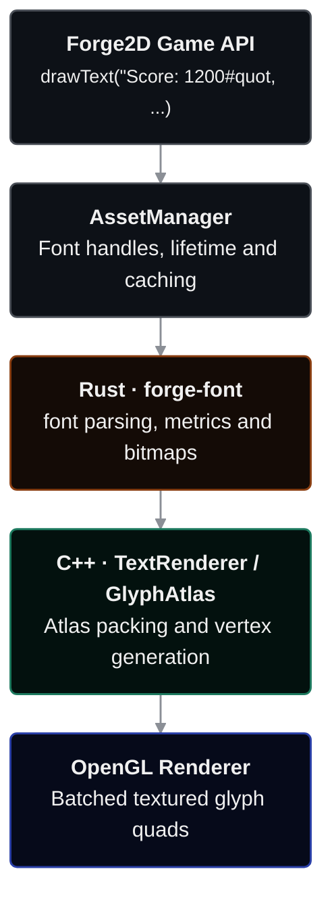

## Rendering Text in Forge2D

Rendering text in Forge2D is exactly what it sounds: loading a font through the asset manager, passing the font through
a font library, and rendering that text to the screen via OpenGL, or whichever rendering backend is compiled in 
(if I eventually add Vulkan or Metal support later on). 

Rendering text in a low-level API like OpenGL however, is the difficult part. Rendering more than 128 different 
same-sized characters, it's probably not too difficult, but when it comes to things like drawing each character at a
different height, width, and margin, things begin to get fairly involved. You may also need to draw more than 128 
characters, draw special symbols for things like mathematical expressions, and draw text from top to bottom instead of
drawing from left to right, just to name a few things. 

There is zero support for text capabilities in OpenGL, so it is up to the developer to define a system for rendering
text to the screen. Since there are no graphical primitives for text characters, several workarounds can be used: 
drawing letter shapes via `GL_LINES`, creating 3D meshes of letters, or rendering characters to 2D quads in a 3D 
environment.

The approach Forge2D will use is the last: render characters to 2D quads in a 3D environment. Though Forge2D is not a
3D game engine, everything is OpenGL is drawn in 3D space, since OpenGL is a 3D graphics API. 

The rendering pipline should look something like this:


### Font Loading

To assist with font loading, forge will make use of the Rust programming language and one of its many, many font 
loading crates. Forge already has an established Rust workspace with two subsystems, `forge-assets` and `forge-audio`
being written in Rust and making use of `images` and `kira` respectively. For fonts, there are lots of creates to
choose from, but the selection has been narrowed down around five crates.

| Crate                                                         | What It Provides                                                        | Assessment for Forge2D                                 |
|---------------------------------------------------------------|-------------------------------------------------------------------------|--------------------------------------------------------|
| [fontdue](https://docs.rs/crate/fontdue/0.9.5)                | Font parsing, fast grayscale glyph rasterisation, metrics, basic layout | Best first implementation                              |
| [ab_glyph](https://docs.rs/ab_glyph/latest/ab_glyph)          | Font loading, glyph positioning and rasterisation                       | Good alternative                                       | 
| [swash](https://docs.rs/swash/latest/swash)                   | OpenType font handling, shaping, hinting and glyph rendering            | More powerful, lower-level                             |
| [cosmic-text](https://docs.rs/cosmic-text/latest/cosmic_text) | Shaping, font discovery, fallback, wrapping, layout and rasterisation   | Best fit for advanced text/UI later                    |
| [freetype-rs](https://docs.rs/crate/freetype-rs/latest)       | Rust bindings for the established FreeType engine                       | Closest to most other engines, but adds a C dependency |

`fontdue` would work quite well for a first implementation. It's a pure-Rust font parser, rasteriser, and text-layout 
library focused on turning TrueType and OpenType fonts into glyph metrics and pixel bitmaps efficiently. It's good for
game HUDs, scores, menus, and debug text. Something like `cosmic-text` or `swash` would be better as later
implementations, as they build a more complex and complete text system.

### How `fontdue` would fit into Forge2D

A new Rust crate, `forge-font`, would be better than expanding `forge-assets` to handle the entire font-rendering
pipeline. The Asset Manager would still load and cache font resources, but Rust would handle parsing and rasterisation,
while the existing C++ OpenGL rendering implementation would handle OpenGL textures and batching.

The important distinction is that Rust **does not need to render text directly**. It will only produce glyph images and
metrics for OpenGL to use.

A first `forge-font` implementation could look like:
```toml
[dependencies]
fontdue = "0.9.5"
```

```rust
use fontdue::{Font, FontSettings};
use std::path::Path;

pub struct FontFace {
    font: Font,
}

pub struct RasterisedGlyph {
    pub width:     usize,
    pub height:    usize,
    pub bearing_x: i32,
    pub bearing_y: i32,
    pub advance:   f32,
    pub bitmap:    Vec<u8>,
}

impl FontFace {
    pub fn load(path: &Path) -> Result<Self, String> {
        let bytes = std::fs::read(path)
            .map_err(|error| error.to_string())?;
        
        let font = Font::from_bytes(
            bytes,
            FontSettings::default(),
        )
        .map_err(|error| error.to_string())?;
        
        Ok(Self { font })
    }
    
    pub fn rasterise(&self, character: char, size: f32) -> RasterisedGlyph {
        let (metrics, bitmap) = self.font.rasterize(character, size);
        
        RasterisedGlyph {
            width:     metrics.width,
            height:    metrics.height,
            bearing_x: metrics.xmin,
            bearing_y: metrics.ymin,
            advance:   metrics.advance_width,
            bitmap,
        }
    }
}
```

That's the basic functionality a first implementation needs.

For a character such as `'A'`, `fontdue` returns its glyph coverage bitmap and metrics describing dimensions, bearings
and advancement. Its `ymin` metric is measured from the baseline to the bottom of the bitmap, so `ymin` can either be
exposed directly or a top bearing can be derived when integrating Forge2D's coordinate system.

Eventually, `forge-bridge` could expose an opaque font handle and function returning glyph data through a C-compatible
interface. Rust's `Vec<u8>` or `FontFace` layouts should not be exposed directly to C++. Instead, the bitmap should be
copied into C++-owned storage or an explicit Rust-side release function should be exposed.

### Rendering

#### Classical Text Rendering:
In the early days, rendering text involved selecting a font, and extracting all relevant characters out of the font to 
place them within a single large texture. That texture is called a bitmap font, and it contains all character symbols 
in predefined regions of the texture. These character symbols of the font are known as glyphs. Each glyph has a 
specific region of the texture coordinates associated with them. When rendering a character, you just select the 
corresponding glyph by rendering this section of the bitmap font to a 2D quad.

This approach has several advantages and disadvantages. It is relatively easy to implement and because bitmap fonts are
pre-rasterised, they're quite efficient. However, it is not particularly flexible. When you want to use a different 
font, you need to recompile a complete new bitmap font and the system is limited to a single resolution; zooming will 
quickly show pixelated edges. Furthermore, it is limited to a small character set, so Extended or Unicode characters 
are often out of the question.

#### Modern Text Rendering: TrueType Fonts
A TrueType font is a collection of character glyphs not defined by pixels or any other non-scalable solution, but by
mathematical equations (combinations of splines). Similar to vector images, the rasterized font images can be 
procedurally generated based on the preferred font height they can be obtained in. By using TrueType fonts, glyphs of 
various sizes can be easily rendered without any loss of quality.

> The following code examples will use the C library, `FreeType`

`FreeType`, and many other font libraries, load these TrueType fonts and for each glyph, generate a bitmap image and
calculate several metrics. Those bitmap images can be extracted for generating textures, and each character glyph can
be positioned appropriately using the loaded metrics.

To load a font, initialise the font library, and load the font as a face:
```c++
FT_Library ft;
if (FT_Init_FreeType(&ft))
{
    std::cout << "ERROR::FREETYPE: Could not init FreeType Library" << std::endl;
    return -1;
}

FT_Face face;
if (FT_New_Face(ft, "fonts/arial.ttf", 0, &face))
{
    std::cout << "ERROR::FREETYPE: Failed to load font" << std::endl;  
    return -1;
}
```

Then define the pixel font size that should be extracted from the face:
```c++
FT_Set_Pixel_Sizes(face, 0, 48);
```

A FreeType face hosts a collection of glyphs. One of those can be set as the active glyph by calling `FT_Load_Char`.
```c++
if (FT_Load_Char(face, 'X', FT_LOAD_RENDER))
{
    std::cout << "ERROR::FREETYTPE: Failed to load Glyph" << std::endl;  
    return -1;
}
```

By setting `FT_LOAD_RENDER` as one of the loading flags, FreeType is told to create an 8-bit grayscale bitmap image
that can be accessed via `face->glyph->bitmap`.

### Glyph Atlases

Most text basic text rendering implementations and tutorials render glyph textures individually. That's fine for
understanding the basics, but with Forge2D's existing batching system, a glyph atlas will be used early on.

Rather than one texture per character, glyphs are stored together in one texture. When game code calls
`renderer.drawText("Score: 1200", font, ...)`, the internal text renderer looks up each glyph in the atlas and submits
a textured quad to a batch. For grayscale font bitmaps, OpenGL's `GL_R8` texture format is a good starting point. The
fragment shader samples the red channel as the glyph's coverage:
```glsl
uniform sampler2D uFontAtlas;

in vec2 vTexCoord;
in vec4 vColour;

out vec4 FragColor;

void main()
{
    float coverage = texture(uFontAtlas, vTexCoord).r;
    
    FragColor = vec4(
        vColour.rgb,
        vColour.a * coverage    
    );
}
```


