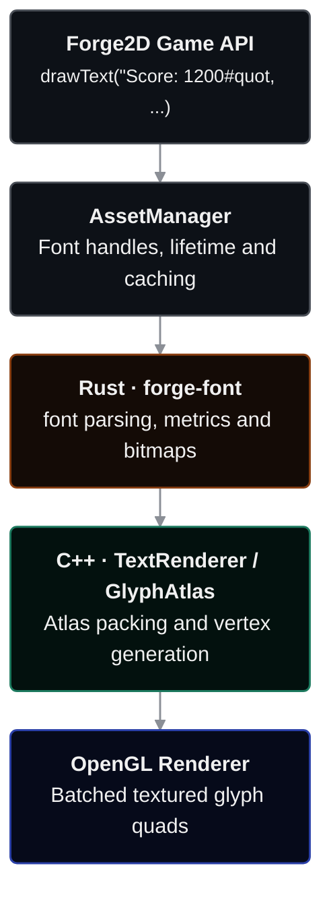
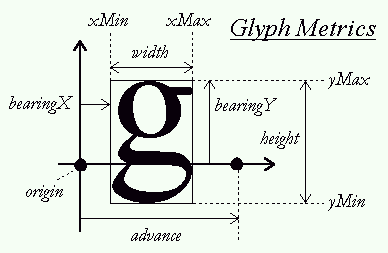

(17 - 11 - 26)

> **Implementation status (18 November 2026):** the initial design below is now
> implemented. `forge-font` uses fontdue 0.9.5, exposed through the existing CXX
> bridge rather than the illustrative raw C ABI. C++ `GlyphAtlas` and `TextRenderer`
> submit glyph quads through the ordered sprite batch. R8 texture swizzling maps
> coverage to alpha, so a separate text shader is unnecessary. See
> [Text rendering usage and implementation](../TextRendering.md) for the actual
> API, lifetime rules, limits, and validation commands. The remaining speculative
> examples below describe design alternatives, not additional shipped APIs.

## Rendering Text in Forge2D

> This design doc was written while following the [Text Rendering](https://learnopengl.com/In-Practice/Text-Rendering)
> LearnOpenGL chapter.

Rendering text in Forge2D is exactly what it sounds: loading a font through the asset manager, passing the font through
a font library, and rendering that text to the screen via OpenGL, or whichever rendering backend is compiled in
(if I eventually add Vulkan or Metal support later on).

Rendering text in a low-level API like OpenGL however, is the difficult part. Rendering more than 128 different
same-sized characters, it's probably not too difficult, but when it comes to things like drawing each character at a
different height, width, and margin, things begin to get fairly involved. You may also need to draw more than 128
characters, draw special symbols for things like mathematical expressions, and draw text from top to bottom instead of
drawing from left to right, just to name a few things.

There is zero support for text capabilities in OpenGL, so it is up to the developer to define a system for rendering
text to the screen. Since there are no graphical primitives for text characters, several workarounds can be used:
drawing letter shapes via `GL_LINES`, creating 3D meshes of letters, or rendering characters to 2D quads in a 3D
environment.

The approach Forge2D will use is the last: render characters onto textured 2D quads. Though Forge2D is not a
3D game engine, OpenGL uses a general graphics pipeline that also works for 2D geometry, often with Z set to zero.

The rendering pipeline should look something like this:


This shows which systems own each part of text rendering, not necessarily a set of calls repeated for every frame.
Once a glyph has been cached in the atlas, a later `drawText` can reuse its existing metrics and UVs without going back
to Rust to rasterise it again.

### Font Loading

To assist with font loading, Forge will make use of the Rust programming language and one of its many, many font
loading crates. Forge already has an established Rust workspace with two subsystems, `forge-assets` and `forge-audio`
being written in Rust and making use of `image` and `kira` respectively. For fonts, there are lots of crates to
choose from, but the selection has been narrowed down around five crates.

| Crate                                                         | What It Provides                                                        | Assessment for Forge2D                                 |
|---------------------------------------------------------------|-------------------------------------------------------------------------|--------------------------------------------------------|
| [fontdue](https://docs.rs/crate/fontdue/0.9.5)                | Font parsing, fast grayscale glyph rasterisation, metrics, basic layout | Best first implementation                              |
| [ab_glyph](https://docs.rs/ab_glyph/latest/ab_glyph)          | Font loading, glyph positioning and rasterisation                       | Good alternative                                       | 
| [swash](https://docs.rs/swash/latest/swash)                   | OpenType font handling, shaping, hinting and glyph rendering            | More powerful, lower-level                             |
| [cosmic-text](https://docs.rs/cosmic-text/latest/cosmic_text) | Shaping, font discovery, fallback, wrapping, layout and rasterisation   | Best fit for advanced text/UI later                    |
| [freetype-rs](https://docs.rs/crate/freetype-rs/latest)       | Rust bindings for the established FreeType engine                       | Closest to most other engines, but adds a C dependency |

`fontdue` would work quite well for a first implementation. It's a pure-Rust font parser, rasteriser, and text-layout
library focused on turning TrueType and OpenType fonts into glyph metrics and pixel bitmaps efficiently. It's good for
game HUDs, scores, menus, and debug text. Something like `cosmic-text` or `swash` would be better as later
implementations, as they build a more complex and complete text system.

### How `fontdue` would fit into Forge2D

A new Rust crate, `forge-font`, would be better than expanding `forge-assets` to handle the entire font-rendering
pipeline. The Asset Manager would still load and cache font resources, but Rust would handle parsing and rasterisation,
while the existing C++ OpenGL rendering implementation would handle OpenGL textures and batching.

The important distinction is that Rust **does not need to render text directly**. It will only produce glyph images and
metrics for OpenGL to use.

A first `forge-font` implementation could look like:
```toml
[dependencies]
fontdue = "0.9.5"
```

```rust
use fontdue::{Font, FontSettings};

pub struct FontFace {
    font: Font,
}

pub struct RasterisedGlyph {
    pub width:         usize,
    pub height:        usize,
    pub xmin:          i32,
    pub ymin:          i32,
    pub advance_width: f32,
    pub bitmap:        Vec<u8>,
}

impl FontFace {
    pub fn from_bytes(bytes: Vec<u8>) -> Result<Self, String> {
        let font = Font::from_bytes(
            bytes,
            FontSettings::default(),
        )
        .map_err(|error| error.to_string())?;

        Ok(Self { font })
    }

    pub fn rasterise(&self, character: char, size: f32) -> RasterisedGlyph {
        let (metrics, bitmap) = self.font.rasterize(character, size);

        RasterisedGlyph {
            width:         metrics.width,
            height:        metrics.height,
            xmin:          metrics.xmin,
            ymin:          metrics.ymin,
            advance_width: metrics.advance_width,
            bitmap,
        }
    }
}
```

That's the basic functionality a first implementation needs. The asset manager can read a `.ttf` or `.otf` file as
bytes and supply those bytes to `forge-font`, instead of the Rust crate also having to know where Forge's assets are
stored. `fontdue` parses and retains its own font data, so the temporary input buffer doesn't have to live as long as
the font object.

For a character such as `'A'`, `fontdue` returns a grayscale coverage bitmap and several metrics. The rasterised
bitmap is arranged from its top-left pixel. The metrics use **pixels at the requested font size**. Unlike FreeType's
26.6 fixed-point advance values in the LearnOpenGL chapter, `fontdue`'s `advance_width` is already an `f32` pixel
measurement. There is no `>> 6` conversion to perform.

The example uses `xmin` and `ymin` rather than calling them `bearing_x` and `bearing_y`. That distinction matters:
`xmin` is the bitmap's left offset from the pen origin, but `ymin` is the offset of the **bottom** edge relative to the
baseline, not the top bearing that the LearnOpenGL example uses. A top bearing can be derived as `ymin + height`.

Eventually, `forge-bridge` could expose an opaque font handle and functions that return glyph data through a stable
C-compatible interface. Rust's `Vec<u8>` or `FontFace` layouts should not be exposed directly to C++. Instead, the
bitmap should either be copied into C++-owned storage or released through an explicit Rust-side function.

### Rendering

The LearnOpenGL chapter uses the FreeType C library for font rasterisation. Forge2D will be doing the same general work,
but through `fontdue` inside the proposed `forge-font` Rust crate.

Modern outline fonts, including TrueType and OpenType fonts, store glyph shapes as mathematical outlines rather than
bitmaps of a fixed size. That is why the same font can be rasterised at 16, 24 or 64 pixels without needing a separate
image file for every size. Rasterisation converts the outlines into actual pixel coverage values for a particular size.

The process in Forge2D would be:

```text
Font file (.ttf / .otf)
    ↓
AssetManager reads font data
    ↓
forge-font parses it using fontdue
    ↓
Request character + pixel size
    ↓
fontdue returns glyph metrics + grayscale bitmap
    ↓
C++ GlyphAtlas uploads the bitmap to an OpenGL texture
    ↓
TextRenderer builds a textured quad for each visible glyph
    ↓
Renderer2D submits the quads as a batch
```

#### Loading a font and rasterising a glyph

There is no library-wide initialisation step equivalent to `FT_Init_FreeType`, and a font is not loaded into a
`FT_Face`. With `fontdue`, the file bytes are passed directly into `Font::from_bytes`:

```rust
use fontdue::{Font, FontSettings};

fn rasterise() -> Result<(), String> {
    let font_data = std::fs::read("fonts/CascadiaCode.ttf")
        .map_err(|error| error.to_string())?;

    let font = Font::from_bytes(font_data, FontSettings::default())
        .map_err(|error| error.to_string())?;

    // Rasterise 'X' at 48 pixels per em.
    let (metrics, bitmap) = font.rasterize('X', 48.0);

    println!("{} x {} ({} pixels)", metrics.width, metrics.height, bitmap.len());
    Ok(())
}
```

The `std::fs::read` above is just a standalone example. In the engine, loading the file should remain the
`AssetManager`'s responsibility, and `forge-font` should receive the font bytes or a font handle through the bridge.

In this example, `font.rasterize` returns two values:

- `metrics`: width, height, offsets, and advance information for the glyph.
- `bitmap`: an 8-bit grayscale coverage image, with one byte per pixel.

A value of `0` in the bitmap means that the glyph covers none of that pixel. A value of `255` means complete coverage,
and values in between are used for anti-aliased edges. The bitmap contains coverage, not a coloured RGB image. Forge2D
can decide what colour the text should be later in the fragment shader.

`48.0` is the rasterisation size in pixels per em, not necessarily the height of the generated bitmap. For example,
`.` may produce a very small bitmap while `B` needs a much larger one at the same requested font size.

Whitespace such as a space may have a non-zero advance but an empty bitmap. The renderer should advance the pen, but it
shouldn't submit an invisible quad or upload a zero-sized image.

#### Glyph metrics

The following image from [LearnOpenGL](https://learnopengl.com/In-Practice/Text-Rendering) shows the general layout of
a glyph relative to a baseline:



The same ideas apply to `fontdue`, although the field names and units are slightly different.

| `fontdue` metric | Meaning |
|------------------|---------|
| `metrics.width` | Width of the rasterised bitmap in pixels |
| `metrics.height` | Height of the rasterised bitmap in pixels |
| `metrics.xmin` | Horizontal offset of the bitmap's left edge from the pen origin |
| `metrics.ymin` | Vertical offset of the bitmap's **bottom edge** from the baseline |
| `metrics.advance_width` | How far to move the pen horizontally after the glyph, in pixels |

A useful derived value is the top bearing:

```c++
const float topBearing = static_cast<float>(glyph.ymin + glyph.height);
```

For example, a letter like `X` usually sits above the baseline, while parts of `g` or `p` extend below it. The offsets
let the renderer position both glyphs correctly, despite their bitmap images having different dimensions.

#### Positioning glyphs on screen

The font metrics themselves don't tell OpenGL where a character should be drawn. Forge2D still has to build its own
quad for each glyph.

For an initial screen-space text API, a top-left origin and a positive Y direction pointing downwards should be used.
Assuming `baselineY` is the current line's baseline, the rectangle for a glyph can be calculated like this:

```c++
// Example only: glyph contains the metrics returned by forge-font.
const float x = penX      + static_cast<float>(glyph.xmin);
const float y = baselineY - static_cast<float>(glyph.ymin + glyph.height);

const float width  = static_cast<float>(glyph.width);
const float height = static_cast<float>(glyph.height);

// Feed x, y, width, height and glyph's atlas UVs into the text batch.
textBatch.addQuad(x, y, width, height, glyph.uv, colour);

penX += glyph.advanceWidth;
```

This formula is for **positive-Y-down coordinates**. For a positive-Y-up world-space renderer, the vertical placement
is different: the glyph's bottom edge starts at `baselineY + ymin`. It is important to pick a convention and keep it
consistent, especially once `Camera2D` and screen-space UI rendering exist.

Also, the `bitmap` returned by `fontdue` starts at the top-left pixel. The atlas UV calculation needs to account for
that so the characters don't render upside down. The easiest approach is to define one UV convention inside
`GlyphAtlas` rather than flipping individual glyphs in game code.

#### Advances, kerning and line spacing

A character's advance isn't the same thing as its visible width. The advance includes the space the font wants before
the next character begins. This is why text cannot be laid out simply by adding every glyph's bitmap width.

Some character pairs also have **kerning**. For instance, the letters `A` and `V` may need to sit slightly closer
together than their individual advances would suggest. `fontdue` provides a horizontal kerning query:

```rust
let pixel_size = 32.0;

let kerning = font
    .horizontal_kern('A', 'V', pixel_size)
    .unwrap_or(0.0);

// Apply this before positioning 'V'.
pen_x += kerning;
```

For a simple string renderer, the general order is:

1. Read the next Unicode character.
2. Apply pair kerning using the previous character, if any.
3. Look up or rasterise the character at the chosen pixel size.
4. Position the glyph quad using its offsets and the current pen position.
5. Move the pen by `advance_width`.

Newlines are handled differently: reset the horizontal pen to the line start and move the baseline to the next line.
`fontdue` provides `horizontal_line_metrics(size)` for values such as ascent, descent and line spacing. Its
`new_line_size` is a useful starting point for the distance between baselines.

`fontdue` also has a basic `Layout` API. I'd use that if it simplifies simple multiline strings and word wrapping,
but not confuse it with a complete text-shaping engine. It doesn't implement all the layout rules needed for every
writing system.

### Glyph Atlases

Most basic text rendering implementations and tutorials render glyph textures individually. That's fine for
understanding the basics, but with Forge2D's existing batching system, a glyph atlas should be used early on.

Rather than having one texture per character, glyphs are stored together in a larger texture. The atlas manager gives
each glyph a rectangle and corresponding UV coordinates, which the text renderer then uses to build quads.

```text
Font: Cascadia Code, 32 px
    ↓
Rasterise 'S', 'c', 'o', 'r', 'e', ':' ...
    ↓
Pack glyph bitmaps into a shared grayscale atlas
    ↓
Store each glyph's UV rectangle + metrics
    ↓
Build quads with positions, UVs and colour
    ↓
Submit all compatible text quads to the sprite/text batch
```

The cache key should at least distinguish the **font face**, **rasterisation size**, and **glyph**. A bitmap rasterised 
at 16 pixels is not the same resource as the same glyph rasterised at 48 pixels. For an initial implementation, a 
character and font size are enough to look up the glyph. If Forge2D later adds advanced shaping, the cache will need to 
work with actual glyph IDs instead of assuming one character always equals one glyph.

Every character should not be rasterised and uploaded in every frame. `forge-font` should only rasterise a glyph on a 
cache miss, and the atlas should keep that bitmap available for subsequent frames.

#### Creating the atlas texture

Since `fontdue` outputs one byte per pixel, an OpenGL texture using the `GL_R8` internal format is a good starting
point. The red channel then stores the grayscale coverage of the glyph.

With OpenGL's Direct State Access API, the atlas could be initialised roughly like:

```c++
GLuint atlas{};

glCreateTextures(GL_TEXTURE_2D, 1, &atlas);
glTextureStorage2D(atlas, 1, GL_R8, 1024, 1024);

glTextureParameteri(atlas, GL_TEXTURE_MIN_FILTER, GL_LINEAR);
glTextureParameteri(atlas, GL_TEXTURE_MAG_FILTER, GL_LINEAR);
glTextureParameteri(atlas, GL_TEXTURE_WRAP_S, GL_CLAMP_TO_EDGE);
glTextureParameteri(atlas, GL_TEXTURE_WRAP_T, GL_CLAMP_TO_EDGE);
```

Here, `1024 x 1024` is just an example size. The actual atlas size, maximum number of pages and packing strategy
should eventually be configurable or derived from the renderer's needs.

When a new glyph gets rasterised, its bitmap is uploaded into an unused region:

```c++
// Example: atlasX/atlasY have already been chosen by the atlas packer.
// The bitmap contains width * height single-channel bytes.
GLint previousAlignment{};
glGetIntegerv(GL_UNPACK_ALIGNMENT, &previousAlignment);

glPixelStorei(GL_UNPACK_ALIGNMENT, 1);

glTextureSubImage2D(
    atlas,
    0,
    atlasX,
    atlasY,
    glyph.width,
    glyph.height,
    GL_RED,
    GL_UNSIGNED_BYTE,
    glyph.bitmap.data()
);

glPixelStorei(GL_UNPACK_ALIGNMENT, previousAlignment);
```

This assumes a non-empty bitmap, a valid destination rectangle and compatible integer dimensions. The backing
texture needs to exist before this upload, and the OpenGL context must be current.

The `GL_UNPACK_ALIGNMENT` change is important. OpenGL normally assumes a row alignment of 4 bytes, but a grayscale
glyph might be 13 pixels wide, meaning each row is only 13 bytes. Setting the alignment to 1 makes OpenGL read those
rows correctly. Because that setting is part of OpenGL's pixel-store state, it should be restored afterwards.

The atlas should also leave some padding around each glyph, especially when using linear filtering, to avoid pixels
from neighbouring glyphs bleeding into each other. A simple shelf or row-based packer is sufficient for a first
implementation; there is no reason to begin with a complex general-purpose texture packer.

If the atlas fills, Forge2D could allocate another page and start a new batch when the page changes. Rebuilding or
moving glyphs in the middle of a frame needs more care, because vertices already submitted with old UVs must not be
left pointing at different pixels.

#### Drawing the atlas in the fragment shader

The fragment shader uses the glyph's red channel as alpha coverage and multiplies it by the requested text colour.

```glsl
uniform sampler2D uFontAtlas;

in vec2 vTexCoord;
in vec4 vColour;

out vec4 FragColor;

void main()
{
    float coverage = texture(uFontAtlas, vTexCoord).r;

    FragColor = vec4(
        vColour.rgb,
        vColour.a * coverage
    );
}
```

That shader works with ordinary straight-alpha blending:

```c++
glEnable(GL_BLEND);
glBlendFunc(GL_SRC_ALPHA, GL_ONE_MINUS_SRC_ALPHA);
```

If Forge2D later uses premultiplied-alpha rendering, the shader and blend factors will need to follow that convention
instead. The fragment shader and the renderer should not silently disagree about how alpha is represented.

#### Integrating text with the existing batching system

The final glyph geometry is not very different from a normal sprite. Each visible character is a textured rectangle:

```text
Glyph
 ├── position
 ├── dimensions
 ├── atlas UVs
 ├── tint colour
 └── atlas texture
```

That means the text renderer does not need to make one `glDrawElements` call for every character. It can generate quads
and submit them through the same general batching system Forge2D already has.

The main concern is preserving draw order. For example:

```c++
renderer.drawRect(background, forge::colours::Black);
renderer.drawText("Score: 1200", font, position, 32.f, forge::colours::White);
renderer.drawSprite(cursor, cursorTransform);
```

The text should appear between the background and the cursor, exactly where the calls occur. If the renderer maintains
separate shape, sprite and text batches, it needs to flush when switching between incompatible batches or render state.
It should not automatically draw all text last just because text has a separate shader.

I would keep a `TextRenderer` or `GlyphAtlas` as an **internal** component, rather than expose the atlas or OpenGL
texture to the game API. The external `Renderer2D` should still only need a font, some text, a transform or position,
a pixel size, and a colour.

---

### Text Layout and Unicode

The first text renderer can focus on single-line and multiline game UI text, but it shouldn't assume every string is
ASCII. `std::string` can hold UTF-8, but iterating over it byte-by-byte does **not** iterate through Unicode
characters. The bridge or text-layout layer will need to decode UTF-8 into Unicode scalar values before calling
`fontdue` with Rust `char` values.

It's also worth separating three things that are easy to mix up:

- **Character**: a Unicode value in the string.
- **Glyph**: a specific visual shape chosen from a font.
- **Glyph placement**: where that visual shape should appear in the final line of text.

For simple Latin strings there is often a nearly one-to-one relationship between characters and glyphs. For more
complex writing systems, combining marks, ligatures and bidirectional text, that relationship can be very different.

`fontdue` is mainly a rasteriser with basic layout helpers. It does **not** provide full OpenType text shaping. This is
not a problem for a first version aimed at debug labels, scores, HUDs and English-language menus, but Forge2D should
not describe that implementation as complete Unicode text rendering.

If Forge2D later needs a much more complete text system, `swash` or `cosmic-text` would be worth reconsidering. In
particular, `cosmic-text` combines shaping, font fallback and text layout with glyph rasterisation. The public
`Renderer2D::drawText` API shouldn't need to change just because the internal font implementation becomes more capable.

Screen-space text and world-space text should also eventually be distinct concepts. HUD text is usually positioned
in screen pixels and should not move when the world camera moves, while text drawn above an entity may need to use
the camera and world transform.

---

### The Rust / C++ boundary

This subsystem should follow the same general FFI design as `forge-assets` and `forge-audio`: Rust does the work it's
responsible for, and the rest of Forge2D shouldn't need to know the details of that implementation.

A possible boundary might expose the following C-compatible types and functions:

```c++
// forge2d_c.h — illustrative API, not implemented yet.

typedef struct F2D_FontFace F2D_FontFace;

typedef struct F2D_GlyphBitmap
{
    int32_t   xmin;
    int32_t   ymin;
    uint32_t  width;
    uint32_t  height;
    float     advance_width;
    uint8_t*  pixels;
    size_t    pixel_count;
} F2D_GlyphBitmap;

F2D_FontFace* f2d_font_create(
    const uint8_t* bytes,
    size_t byte_count
);

bool f2d_font_rasterise(
    const F2D_FontFace* font,
    uint32_t unicode_scalar,
    float size,
    F2D_GlyphBitmap* out_glyph
);

void f2d_font_free_glyph(F2D_GlyphBitmap* glyph);
void f2d_font_destroy(F2D_FontFace* font);
```

`F2D_FontFace` is intentionally opaque, so C++ doesn't have to know about `fontdue::Font`. The C++ side owns the
font handle's lifetime, while `forge-font` retains the actual Rust object. The font byte pointer passed to
`f2d_font_create` would be borrowed for the duration of that call, and Rust would retain its own font data as needed.

The glyph bitmap is explicitly released using `f2d_font_free_glyph`, because C++ must not call `delete[]` or `free()`
on memory allocated with Rust's allocator. The bridge should validate Unicode scalar values, sizes and pointers, and
it must not let a Rust panic unwind across the FFI boundary. Failures should be reported through a return value and an
engine error-reporting mechanism.

This is just one possible ABI. Another option is having C++ supply a destination buffer so Rust doesn't have to
allocate memory for every bridge call. The important part is that ownership is documented and no Rust-specific
containers or object layouts escape into public C++ headers.

The font rasteriser should also be testable without an OpenGL context. OpenGL texture creation and atlas uploads
remain exclusively on the C++ renderer side, while Rust can parse and rasterise font data on its own.

---

### Game-facing API

The game API should stay small. For example:

```c++
const forge::Font* gameFont{};

void onStart(forge::AssetManager& assetManager) override
{
    gameFont = &assetManager.loadFont("fonts/CascadiaCode.ttf");
}

void render(forge::Renderer2D& renderer) override
{
    renderer.drawText(
        "Score: 1200",
        gameFont,
        { 100.f, 100.f },
        32.f,
        forge::colours::White
    );
}
```

This follows the API shape Forge2D is currently using. The exact `Font` ownership model may change, though. The
pointer version above assumes the `AssetManager` guarantees stable references for the font's lifetime. A dedicated
`FontHandle` would make that lifetime contract easier to enforce if the resource manager supports unloading or
reloading assets.

The API can eventually grow to support alignment, wrapping, world-space text and other options, but those do not
need to be designed into the first implementation.

For example, a future API might use a settings struct:

```c++
renderer.drawText(
    "Level Complete!",
    font,
    forge::TextStyle {
        .size = 48.f,
        .colour = forge::colours::White
    },
    { 400.f, 300.f }
);
```

That snippet is only a possible direction, not a requirement for the first release.

---

### Sources / Useful Reading

- [LearnOpenGL - Text Rendering](https://learnopengl.com/In-Practice/Text-Rendering)
- [fontdue 0.9.5](https://docs.rs/crate/fontdue/0.9.5)
- [fontdue Font API](https://docs.rs/fontdue/0.9.5/fontdue/struct.Font.html)
- [fontdue Glyph Metrics](https://docs.rs/fontdue/0.9.5/fontdue/struct.Metrics.html)
- [OpenGL Wiki - Pixel Store](https://wikis.khronos.org/opengl/GLAPI/glPixelStore)
- [OpenGL Wiki - Texture Formats](https://wikis.khronos.org/opengl/Texture#Image_formats)
- [cosmic-text](https://docs.rs/cosmic-text/latest/cosmic_text/)
