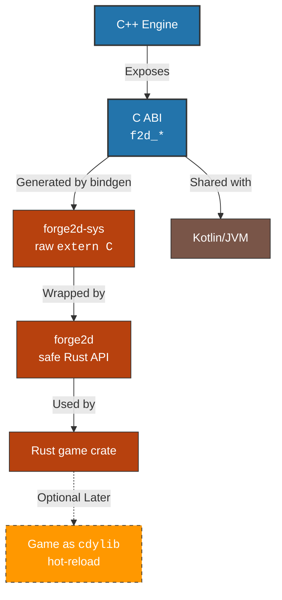

(01 - 11 - 2026)
## Rust Scripting in Forge2D

#### Writing game code in the language Rust

This is an eventual feature of Forge2D that will let developers write game code in Rust, the engine's secondary core
language. Like the planned Kotlin frontend (see `KotlinScripting.md`), it goes through the same flat C API
(`forge2d_c.h`), so both frontends share one boundary rather than each binding the C++ classes directly.

The Rust side should be kept close to what is currently in C++ under `games/platformer/src`: a `Game` with lifecycle
methods, config passed in as plain structs, and input that gets polled each frame. Rust has no inheritance, so the
`Game` base class becomes a trait. The parts that need more thought are underneath the general syntax: how calls cross
from Rust into C++, how Rust's ownership and lifetimes map onto engine-owned resources, and what happens when a panic
or exception hits the boundary.

### Where the Rust side should end up

`main.rs`: struct update syntax with `..Default::default()` does the same job as the current C++ designated 
initialisers.
```rust
use forge2d::prelude::*;

fn main() -> forge2d::Result<()> {
    Application::new(ApplicationConfig {
        window: WindowConfig {
            title:  "Forge2D Platformer".into(),
            width:  800,
            height: 600,
            vsync:  true,
            ..Default::default()
        },
        ..Default::default()
    })?
    .run(PlatformerGame::default())
}
```

`platformer_game.rs`:
```rust
use forge2d::prelude::*;

#[derive(Default)]
pub struct PlatformerGame {
    player:   Option<Texture>,  // a handle, not a GPU object
    position: Vec2,
}

impl Game for PlatformerGame {
    fn on_start(&mut self, assets: &mut AssetManager) -> forge2d::Result<()> {
        self.player   = Some(assets.texture("textures/player.png")?);
        self.position = Vec2::new(100.0, 100.0);
        log::info!("Platformer started!");
        Ok(())
    }

    fn on_stop(&mut self) {
        log::info!("Platformer stopped!");
    }

    fn update(&mut self, time: Time, input: &Input) {
        if input.is_down(Key::D) { self.position += Vec2::RIGHT * 200.0 * time.delta(); }
        if input.is_down(Key::A) { self.position += Vec2::LEFT  * 200.0 * time.delta(); }
    }

    // The renderer is borrowed for this frame only, so it can't be stashed away and used later
    fn render(&mut self, r: &mut Renderer2D) {
        r.clear(Colour::CORNFLOWER_BLUE);
        if let Some(player) = self.player {
            r.sprite(player, self.position);
        }
        r.rect(Transform2D { position: Vec2::new(0.0, 550.0), size: Vec2::new(800.0, 50.0), ..Default::default() },
               Colour::DARK_GREY);
    }
}
```

This maps directly onto conventional game code (`Input::isKeyDown(Key::D)`, `renderer.drawSprite(texture, pos)`), so
the C++, Kotlin and Rust frontends stay one-to-one.

Rust in these examples differs from the C++ and Kotlin versions in a few ways:
- `Game` is a trait with default (empty) methods for `on_start` / `on_stop`, mirroring the C++ `virtual` defaults.
- `on_start` returns a `Result`, so asset loading can use `?` instead of exceptions.
- Input is passed in as `&Input` rather than read from global state, which keeps the borrow checker happy and makes it
  obvious which code reads input. A global `Key::D.is_down()` style helper could still be added on top later.
- `&mut Renderer2D` is a borrow scoped to `render()`, so the "don't use the renderer outside of render" rule is
  enforced by the compiler rather than by documentation.
- `Time` instead of a bare `f32`, since there are already `Time` and `Clock` classes in the C++ engine.

Later, once scenes have been added, the same idioms extend to a component layer without breaking the simple `Game`
API. A builder fits Rust better than a nested DSL:
```rust
#[derive(Default)]
pub struct PlayerController { pub speed: f32 }

impl Behaviour for PlayerController {
    fn update(&mut self, ctx: &mut BehaviourCtx, time: Time) {
        if ctx.input().is_down(Key::D) {
            ctx.transform_mut().position += Vec2::RIGHT * self.speed * time.delta();
        }
    }
}

let player_tex = assets.texture("textures/player.png")?;

let level1 = Scene::builder()
    .entity("player", |e| e
        .transform(Vec2::new(100.0, 100.0))
        .sprite(player_tex)
        .behaviour(PlayerController { speed: 250.0 }))
    .build();
```

Builders should be kept for scene and entity construction, where chaining really helps. For configs, plain structs
with `Default` are enough.

### How Rust talks to the engine

As with Kotlin, C++ classes will not be bound directly (e.g. through `cxx` or `autocxx`). Rust is layered on top of
the same flat C API, split into the usual two crates:


- `forge2d-sys` is the only crate with `unsafe` FFI. Its `build.rs` builds the engine through the `cmake` crate and
  runs `bindgen` over `forge2d_c.h`. Checking the generated bindings in (rather than generating them on every build)
  avoids needing libclang on every machine.

- `forge2d` is the safe wrapper: handles, traits, `Result`s and lifetimes all live here. Games only ever depend on this
  crate.

- Why not `cxx` / `autocxx`: they bind C++ directly, which would tie the Rust API to C++ class layouts and duplicate
  work the C API already has to do for Kotlin. One boundary for every frontend is easier to keep stable.

- Who owns `main`: the simplest setup has Rust owning `main` and linking the engine as a static or shared library,
  the same as Kotlin. Unlike Kotlin there is no runtime to embed, so the reverse (the C++ `main` loading a Rust game
  built as a `cdylib`) is also cheap, and is the natural route to hot-reloading game code later via `libloading`.

### Three design rules that affect the current C++ side
- **Resources are handles**: `Texture` on the Rust side should be `#[derive(Clone, Copy)] #[repr(transparent)] struct
  Texture(NonZeroU32)`, with the engine owning the actual GL texture. The current C++ `Texture2D` is a reference
  counted `shared_ptr`, which can't cross a C boundary, so the C API should hand out ids into the `AssetManager`
  instead. `Drop` is deterministic in Rust (unlike Kotlin's GC), but a handle still must not free GPU memory after the
  window is gone, so lifetimes should stay with the asset manager and plain ids stay `Copy`.

- **Batch draw calls; don’t make one native call per draw**: Rust FFI calls are far cheaper than JVM ones, but
  `sprite(...)` should still write into a shared command buffer (`#[repr(C)]` structs in a `Vec` or an engine-owned
  slice), and the engine flushes it once per frame. This keeps the Rust and Kotlin paths identical and fits the
  sprite/shape batching currently in the TODO list.

- **Math types are plain data**: Unlike Kotlin, Rust can pass `#[repr(C)] struct Vec2 { x: f32, y: f32 }` across the
  boundary by value with no packing tricks. This only works if the C++ `Vec2`, `Colour`, and `Transform2D` are
  converted into pure data with `static_assert(std::is_standard_layout_v<...>)`, and the Rust side should mirror that
  with layout tests (`assert_eq!(size_of::<Vec2>(), 8)`) so the two definitions can't silently drift apart.

### Changes to the current C++ API that would make this easier
- `Game` could become a callback table. `Application` right now takes in a `std::unique_ptr<Game>`, which a foreign
  language can't subclass. At the C level, a struct of `extern "C"` function pointers plus a `void* userData` would
  make this much easier. On the Rust side, `userData` is a `Box<dyn Game>` turned into a raw pointer and recovered in
  each trampoline; the C++ `Game` becomes an adapter over the same table.

- Neither exceptions nor panics may cross the boundary. Under `games/platformer/src`, `main.cpp` catches exceptions
  right now. The C API should return error codes or a last-error string, which `forge2d` turns into a `Result`. In the
  other direction, every Rust trampoline called by the engine must wrap the game's code in
  `std::panic::catch_unwind` and report the panic as an error, since unwinding into C++ is undefined behaviour.

- GL-thread affinity should be explicit. Engine handles and the renderer should be `!Send` / `!Sync` on the Rust side,
  so the compiler rejects using them off the main thread, matching the existing "must be called on the GL thread"
  comments in `Texture2D.hpp`.